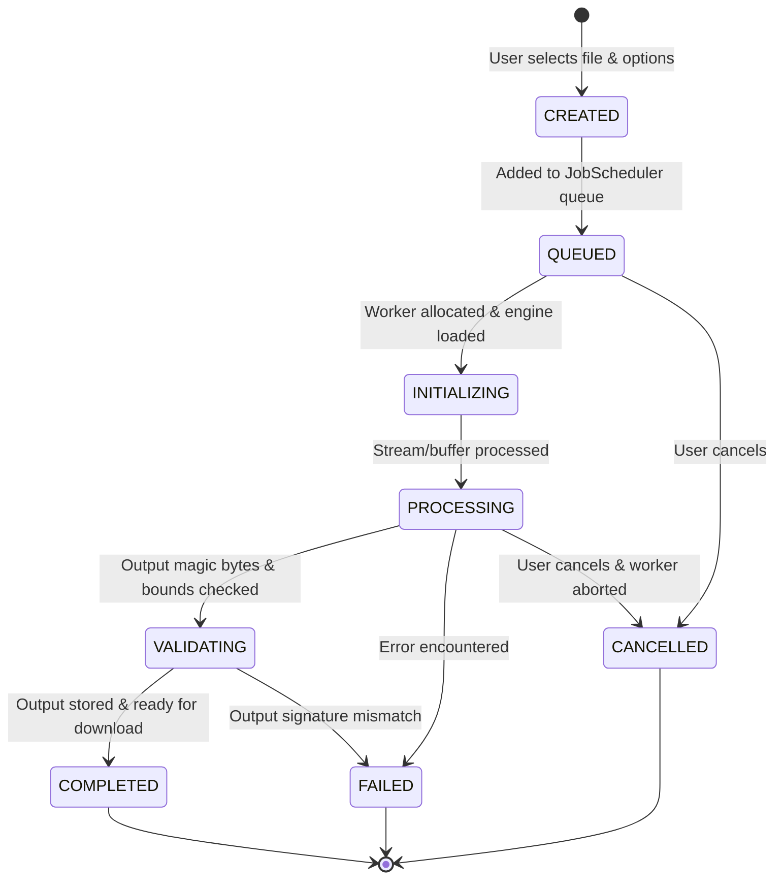

# MediaForge — Project Context & System State (context.md)

This document maintains the active system state, domain specifications, environment attributes, and active task tracking for MediaForge.

---

## 1. Project Domain Overview

**MediaForge** is a privacy-first, universal, local media processing and conversion platform. All processing occurs 100% on the user's device using browser-native APIs, WebAssembly, and local ONNX AI models.

### Key Tenets
1. **Zero Data Egress**: No user files or media data are sent to external servers or cloud APIs.
2. **True Processing**: No fake progress, fabricated sizes, or mock conversions.
3. **Multi-Surface**: Delivered as a modern Web App, an offline-capable PWA, and a Chrome/Edge Manifest V3 extension.
4. **Shared Core Engine**: Shared TypeScript packages (`@mediaforge/*`) power both web and extension targets.

---

## 2. Active System Environment

* **Host OS**: Windows 11 (build environment)
* **Processor**: Intel Core i7-1165G7 @ 2.80GHz (4 Cores / 8 Threads)
* **Memory**: 16 GB Physical RAM
* **Storage**: C: drive (~20 GB free space allocated for workspace)
* **Runtime**: Node.js `v22.15.1`, npm `10.9.2`, Git `2.49.0`
* **Package Manager**: pnpm (target workspace manager)
* **Repository Root**: `c:\Users\manit\OneDrive\Desktop\Projects\Self\Media Forger`

---

## 3. Core Domain State Machine: Job Lifecycle

Every processing task in MediaForge conforms to the following strict lifecycle:

### Job Contract Specification
* `id`: UUID v4
* `file`: Source file reference or OPFS path
* `inputFormat`: Detected format ID (via magic bytes)
* `outputFormat`: Target format ID
* `options`: Transformation, compression, resize, quality configurations
* `progress`: 0.0 to 1.0 (actual processed progress)
* `status`: `created` | `queued` | `initializing` | `processing` | `validating` | `completed` | `failed` | `cancelled`
* `error`: Standardized error payload if failed
* `result`: Output Blob / ArrayBuffer, verified MIME, output byte size, duration/dimensions

---

## 4. Current Workspace State

* **Active Phase**: Phase 1 through Phase 8 core delivery completed and verified.
* **Apps Built**:
  - `apps/web`: Full SaaS React 19 + Vite 6 + Tailwind web app with all 11 studio pages, scoped per-studio file isolation, interactive AI Studio workspace (2x/4x Super-Resolution, IS-Net ONNX Deep Neural Background Removal & Replacement Studio with WebGPU/WASM, Eyedropper, Solid/Gradient/Bokeh/Image replacement, edge choke/expand, and drop shadows), audio/video scrubbing and controls, real MP3/WAV export, and PWA offline capability. Production build passed (`apps/web/dist`).
  - `apps/extension`: Chrome Manifest V3 extension with background service worker, offscreen processing document, popup, side panel, and context menus. Production build passed (`apps/extension/dist`).
* **Shared Packages**: 15 `@mediaforge/*` packages compiled and linked.
* **Automated Tests**: 7 Vitest test suites (29 unit tests) passing with 100% success rate.
* **Blockers**: None. Ready for end-user execution and extension unpacking.
