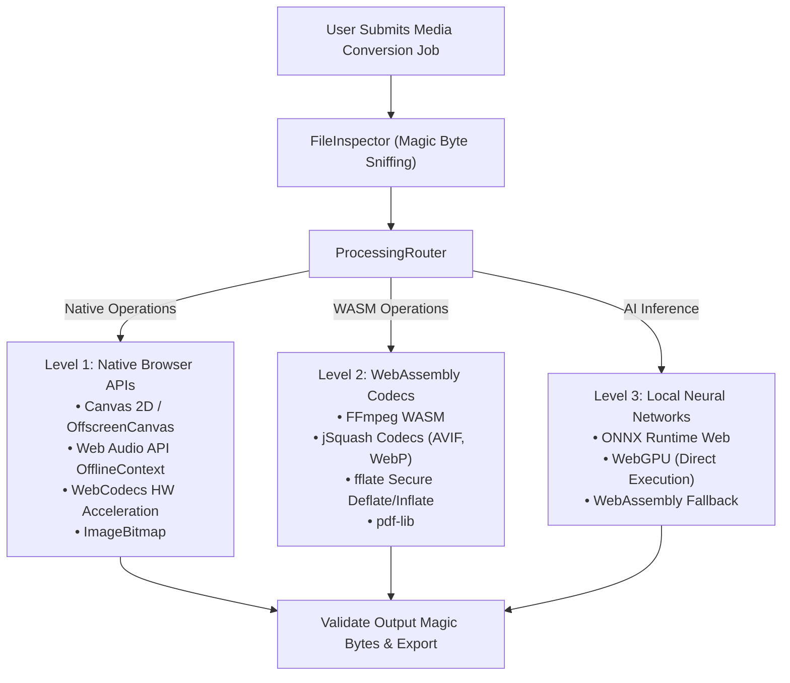

# MediaForge — System Architecture

MediaForge is a universal, privacy-first, local media processing and conversion platform.
All media processing runs 100% on the user's device using browser-native APIs, WebAssembly, and local ONNX AI models.

---

## 1. Monorepo Structure

```
mediaforge/
├── apps/
│   ├── web/               # SaaS React 19 + Vite 6 + Tailwind + PWA Web Application
│   └── extension/         # Chrome & Edge Manifest V3 Browser Extension
├── packages/
│   ├── shared-types/      # Core interfaces, enums, format contracts, job lifecycle
│   ├── validators/        # Zod schemas, magic bytes signatures, filename/zip-slip sanitization
│   ├── database/          # Dexie.js (IndexedDB) tables for jobs, files, presets, history, cache
│   ├── storage/           # OPFS manager, StorageQuota detector, safe ObjectUrlManager
│   ├── wasm-runtime/      # Dynamic WASM loader with CacheStorage caching
│   ├── worker-runtime/    # WorkerPool, message protocol, transferable ArrayBuffers
│   ├── presets/           # Built-in presets for images, audio, video, compression
│   ├── core/              # FormatRegistry, FileInspector, CapabilityDetector, ProcessingRouter, JobScheduler, ExportManager
│   ├── image-engine/      # Canvas 2D/OffscreenCanvas, filters, resize, crop, rotate, flip, watermark, base64
│   ├── audio-engine/      # Web Audio API decode, waveform peaks, volume normalize, fade, 16-bit PCM WAV
│   ├── video-engine/      # Video metadata inspection, hardware frame/thumbnail capture
│   ├── document-engine/   # CSV ↔ JSON converter, TXT line-break normalization
│   ├── archive-engine/    # fflate-based secure ZIP creator and extractor with zip-slip guard
│   ├── ai-engine/         # ONNX Runtime Web manager, WebGPU/WASM resolver, model registry
│   └── ui/                # Theme tokens, cn utility, shared UI styles
├── tests/
│   └── unit/              # Vitest test suites (format-registry, validators, document, archive, file-inspector)
└── docs/                  # Architecture, format support, security, privacy, extension documentation
```

---

## 2. Three-Tier Intelligent Processing Router

MediaForge employs an intelligent 3-level tiering architecture to minimize resource overhead:



---

## 3. Dedicated Web Worker Architecture

To guarantee a fluid 60 FPS user experience:
1. All CPU-intensive transcoding, resizing, audio rendering, and compression run inside dedicated Web Workers.
2. Large buffers are passed across the boundary using `Transferable` ArrayBuffers where possible to eliminate buffer duplication.
3. High-throughput files leverage the Origin Private File System (OPFS) for direct file streaming without exceeding V8 heap limits.

